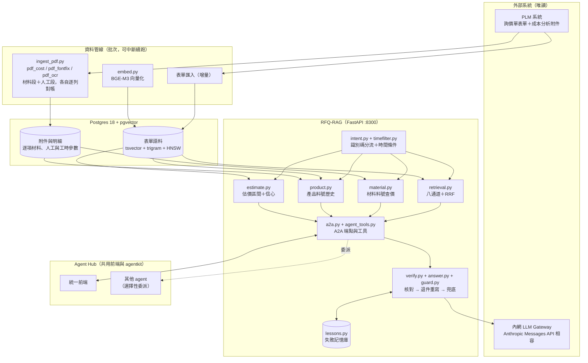

# 架構

> 本文件說明技術架構與設計理由。公開版不含資料、SQL 與資料表結構，程式無法實際運作。

一句話：**FastAPI 服務＋Postgres/pgvector**，用「先分流、再多通道檢索」取代單一向量搜尋，
用「量出來的信心等級」決定估價結果能不能用，再用「確定性核對」擋住模型自己編的數字。
對外只有 A2A 協定，本身沒有網頁。



## 各層在做什麼

**資料管線**——表單匯入、附件下載、PDF 解析、向量化各自是獨立的批次，各自認一個增量鍵，
可以中斷後續跑；一段失敗不影響其他段，advisory lock 擋兩輪重疊。
批次刻意不放進 API 服務：OCR 與向量化是 CPU 飽和型，會拖慢線上查詢。
公開版只保留 PDF 解析（`ingest_pdf.py`）與向量化（`embed.py`）兩段的程式。

**PDF 解析的三層**——成本分析表版式固定，但文字層常常壞掉：

1. **字型表修復**（`pdf_fontfix.py`）：ToUnicode 對照表壞掉時，依字寬比對系統字型推回正確字元；
   推不出唯一解就保留亂碼（亂碼看得出是壞的，看起來像中文的假值看不出來）。
2. **OCR**（`pdf_ocr.py`）：掃描件用 RapidOCR，但欄位邊界取自 PDF 自己的向量框線；
   分數不足、框沒蓋滿儲存格、整格漏偵測的，單獨裁出該儲存格拉高 DPI 重讀，
   而且只換更完整的答案，不換更短的；救不回信心的欄位標「請核對 PDF」，不硬猜。
3. **算式對帳**（`pdf_cost.py`）：材料段用「單價×用量×耗損＝總價」抓出小數點被認錯的格，
   人工段用「費率×工時÷3600÷效率」或「費率÷PPH」驗每一列，再對 Σ 與小計。

**分流**——三種識別碼各有自己的精確查法，而且分流發生在檢索之前：

| 長相（範例為虛構） | 是什麼 | 誰負責 |
|---|---|---|
| `RFQ-20220816010-001` | 單號 | `retrieval.by_number` |
| `MAT5120734` | 材料料號（附件逐項單價） | `material.lookup` |
| `AX52K8D61930-3` | 產品料號（表單的料號欄） | `product.lookup` |

漏掉一種識別碼的症狀不是「查不到」而是幻覺：問句掉進語意檢索，模型拿到一批不相干的單子。
識別碼比對一律用 `(?<![A-Za-z0-9])…(?![A-Za-z0-9])` 而不是 `\b`：`\w` 含中日韓字元，
中文問句不留空格，用 `\b` 的症狀是「有空格就對、沒空格就錯」。

**檢索**——`retrieval.py` 一次查詢同時跑八條通道（編號、數值條件、時間、有無附件、結構欄位、
同義詞、全文、向量），以 RRF（Reciprocal Rank Fusion）加權融合：確定性強的通道權重最高，
向量最低；向量不可用時跳過該通道，其餘照跑。時間條件的排序在融合與跨單型去重**之後**才做，
保證「最近一份」真的是最新的。

**估價**——`estimate.py` 不是另一套模型，是同一份向量索引的 k-NN，差別在多算了
「鄰居之間的離散度」；離散度低才標 `confidence=high`，門檻用獨立樣本量出來
（high 等級 2 倍內準確率約 84%），medium／low 會明講要走完整 BOM 估算。

**回答核對**——模型寫完之後，`verify.py` 拿它對照這一題的檢索結果做確定性核對：
每個數字、編號、檔名都要找得到出處，不可以有 `X USD` 這種佔位符，不可以查到了卻說查無，
不可以概括否認附件存在。沒過就把「錯在哪一句」送回去重寫，最多五次；都沒過就直接列出檢索結果。
檢索本身空手時連 LLM 都不呼叫。每一次退件以「路徑＋違規類型」為鍵寫進失敗記憶庫，
下一次同一條路徑的 prompt 就看得到那條教訓。`guard.py` 讓模型自己跑工具迴圈的那條路也走同一套核對。

**服務層**——`agent_tools.py` 是唯一一份工具定義，`a2a.py` 把它包成 agentkit 的
`AgentSpec`（`agent_id="rfq"`）掛進 FastAPI。`admission.py` 限制同時檢索數、滿了立刻回忙碌；
`db.py` 讓 API 與批次各自有查詢預算；整題的總期限（`vendor/agentkit/deadline.py`）沿呼叫鏈往下傳；
`/readyz` 不能服務時回 503，給 Docker HEALTHCHECK 與部署門檻用。

**系統自我說明**——問「你可以做什麼」時，`intent.py` 在檢索之前攔下來，答案由 `intent.ROUTES`
組出、不經過 LLM，並實際跑一次分流驗證每個範例走到宣稱的那條路。過時的自我說明等於對使用者說謊。

## 資料庫與 SQL 技術

公開版移除了所有 SQL（建表、索引、查詢），資料表與欄位結構也不公開；這裡只說明做法與理由。

**一張表兩個檢索方向**——一筆詢價單＝一列＝一個檢索單元，不做 chunking。這是結構化紀錄檢索，
不是長文件 RAG：「編號 → 成本」與「描述／條件 → 編號」兩個方向落在同一列上，不需要兩套索引，
也不需要另開向量庫做同步。

**同一張表掛四種索引**

| 索引 | 用途 |
|---|---|
| B-tree（多數是 partial index，只索引有值的列） | 編號、類別、狀態、成本欄的等值與範圍條件 |
| GIN + pg_trgm | 編號、料號打一半也查得到；附件品名的相似度反查（`similarity()`，OCR 讀錯字也能命中） |
| GIN + tsvector（`simple` 設定） | 全文檢索；中文不分詞，詞之間用 OR，一個沒命中的詞不會拖垮整句 |
| HNSW（pgvector，cosine，1024 維） | 語意檢索；另有一條只索引「有成本明細」那批列的局部向量索引，估價的 k-NN 不必掃其餘大多數列 |

**查詢的寫法**

- **硬性條件推進 SQL**：數值條件（「材料成本大於 100」）與時間區間直接變成參數化的 `WHERE`，
  不是先撈候選再在 Python 裡篩；欄位名稱來自白名單，使用者輸入一律走參數，不做字串拼接。
- **「有沒有附件」用 `EXISTS` 子查詢**，而且跟時間區間合併在同一條查詢裡 ——
  事後過濾的話，「這段時間最新的 N 筆」常常剛好一筆附件都沒有。
- **多通道各查各的，再用 RRF 融合**：每條通道各取前 N 筆候選，`score = Σ weight / (k + rank)`。
- **詞頻一次批次查完**：同義詞展開需要每個詞的文件頻率，一次查詢算完，不在迴圈裡逐詞查。
- **0 與未填是兩件事**：成本欄一律用 `IS NULL` 判斷「沒填」，絕不用 `= 0`；
  `numeric` 回來是 `Decimal`，序列化前轉回數字，`None` 保持 `None`。

**寫入與批次**

- **Upsert**：`INSERT … ON CONFLICT DO UPDATE`，增量重疊一天也不會重複；描述文字變了才把
  向量清空重算，沒變就保留，不必整批重新向量化。
- **去重鍵是相對路徑鍵**：附件存相對 `DOC_ROOT` 的鍵而不是磁碟路徑，搬目錄只改一個環境變數，
  同一個檔案也不會因為寫法不同被當成兩份。
- **建表一律 `IF NOT EXISTS`**，加欄位走 `ADD COLUMN IF NOT EXISTS`：對有資料的庫重跑永遠安全；
  清空重建刻意不放在建表流程裡，是另一個需要明確確認的操作。
- **advisory lock**：批次拿不到鎖就退出，兩輪不會重疊寫同一批資料。

**查詢預算（一條慢查詢不能拖垮服務）**

- API 與批次分開兩種 profile：API 每條查詢有 `statement_timeout`、`lock_timeout`、
  idle-in-transaction 期限，取連線也有等待與排隊上限；批次不設 statement 期限。
- 逾時、鎖等待、斷線一律往上拋，不被通道吞成「沒有結果」—— 吞掉的話使用者拿到的是少了幾條通道、
  看起來卻完全正常的答案。只有全文語法錯誤會被吞掉，其餘通道照跑。
- 資料庫查詢移出事件迴圈（thread pool），一條慢查詢不會卡住同一個 worker 的其他請求。

## 一次查詢的路徑（例：「MAT5120734 多少錢」）

```
Agent Hub ──POST /a2a/message──▶ a2a.py
                                   │ intent.parse()：材料料號
                                   ▼
                         material.lookup()  （依料號查附件材料明細）
                                   │
                                   ▼
                         _deep() 把 Decimal 轉回數字（None 保持 None）
                                   │
                                   ▼
                         LLM 依驗算狀態／幣別／版本時間組出回答
                                   │
                                   ▼
                         verify.check() ── 通過 ──▶ SSE 串回
```

## 技術選型

| 用途 | 選擇 | 為什麼 |
|---|---|---|
| API 框架 | FastAPI，單一 `/a2a/*` 路由 | 前端統一在 Agent Hub，這裡只當後端 |
| 多 agent 契約 | agentkit（`vendor/` 內附） | 多個 agent 共用同一種 A2A 形狀 |
| 資料庫 | Postgres 18 + pgvector + pg_trgm | 向量、全文、trigram、結構化條件同一張表查，不必另開向量庫做同步 |
| 向量模型 | BAAI/bge-m3（1024 維，本機 CPU） | 多語言，中英混雜的型號與規格描述不必另訓模型；資料不出內網 |
| 編碼執行期 | Docker 走 onnxruntime＋官方 ONNX；本機可切 sentence-transformers | 向量數值一致，API image 2.66 GB → 541 MB；代價是批次重算慢約 45% |
| 檢索策略 | 八通道＋RRF，不是純向量 | 數字表格會稀釋向量；確定性條件必須是硬過濾，不是排序訊號 |
| 幻覺防治 | 確定性核對＋退件重寫，不是 LLM-as-judge | 會編數字的是模型，找它編的數字也是它；字串比對正確率 100%、微秒級 |
| 自我學習 | 記「路徑＋違規類型」，不是記問句 | 使用者發現答錯就換個問法，會重複的是錯誤的形狀 |
| LLM | 內網 gateway（Anthropic Messages API 相容） | tool-use 介面相容，工具定義只維護一份；資料不出內網 |
| PDF 解析 | pdfplumber＋字型表修復＋RapidOCR＋算式對帳 | OCR 最貴且會產生新錯誤，先試不用 OCR 的辦法，事後再用算式驗算 |
