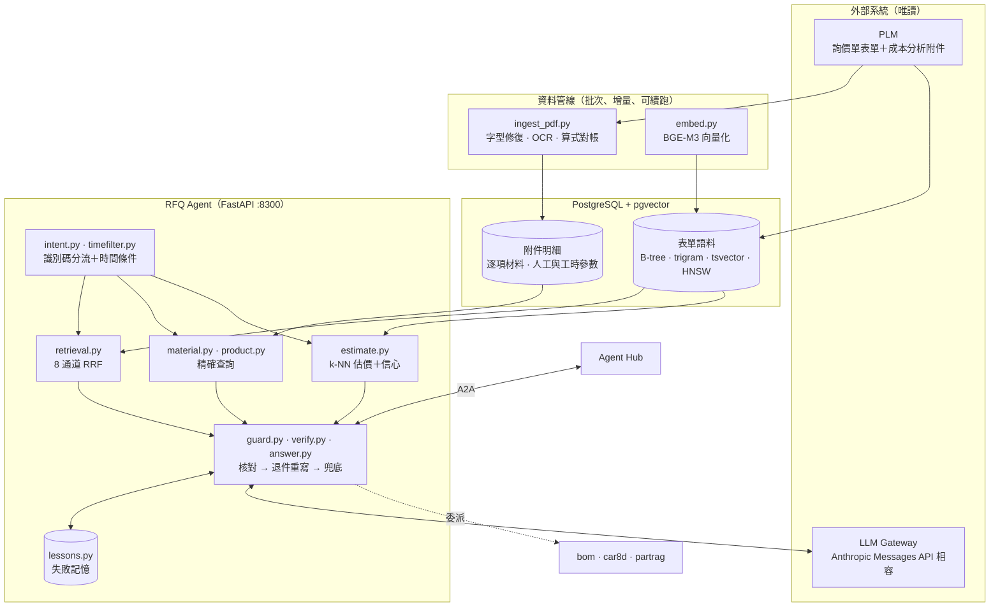
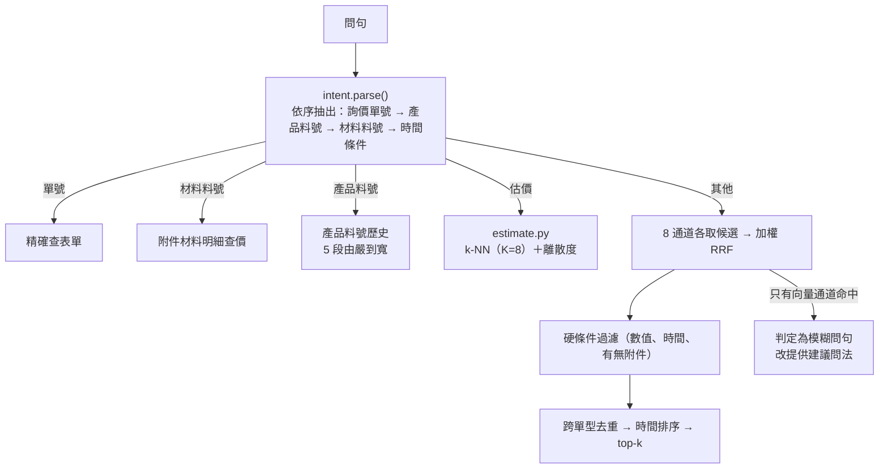
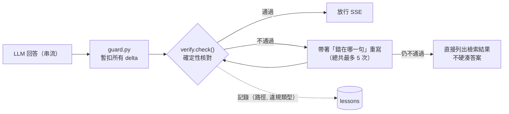

# RFQ-RAG — 詢價單成本查詢與估價 Agent

> **一句話介紹**：業務接到客戶詢價時問「以前做過類似的嗎？大概多少錢？」，它從歷史詢價單和附件成本分析表裡找出可核對的數字，並給新規格一個附信心等級的成本區間。

**系統導覽**：[Agent Hub（主入口）](https://github.com/LiN3simver/Agent_Hub_RAG_Frontend) · [Part-RAG](https://github.com/LiN3simver/Part-RAG) · **RFQ-RAG** · [BOM-RAG](https://github.com/LiN3simver/Bom-RAG) · [8D-Report-RAG](https://github.com/LiN3simver/8D-Report-RAG) · [ISO-RAG](https://github.com/LiN3simver/ISO-RAG)

> **作品集展示版**：不含資料、SQL（程式內以 `[SQL 已於公開版移除]` 佔位）、資料表結構、測試與評測題庫，無法實際查詢。公司名（ACME）、客戶、料號與單號皆為虛構。

---

## 專案概覽

製造業回覆客戶詢價時，要翻歷史詢價單（RFQ／RFS／RFD）與附在單子底下的「成本分析表」PDF——其中約三成附件沒有可用的文字層。這個 Agent 把兩者變成可用自然語言查詢的知識庫：**先分流再檢索**取代單一向量搜尋，以**量出來的信心等級**決定估價能不能用，再以**確定性核對**擋下模型自己編的數字。

| 問法（範例） | 系統做什麼 |
|---|---|
| 「RFQ-20260507024-001 的材料成本？」 | 依單號精確查表單 |
| 「MAT5120734 以前多少錢？」 | 從附件逐項材料表查單價、幣別、版本 |
| 「這份成本分析表的人工成本怎麼算的？」 | 列出工站、工時、PPH、費率、效率與代入數字的算式 |
| 「MCIO 8X、線長 600mm 以前大概多少錢？」 | k-NN 估出歷史成本區間＋信心等級 |
| 「最近一份 AX52K8D61930-3 的報價」 | 產品料號＋時間條件（硬過濾＋排序） |

## 核心功能

- **三種識別碼各查各的**：詢價單號、材料料號、產品料號在檢索前就解析，不會把料號丟進語意檢索亂搜
- **讀懂成本分析附件**：從 PDF 抽出逐項材料單價與人工工時，並用表格自己的算式逐列對帳
- **估價附信心等級**：依相似歷史案例的成本離散度分級，低信心時明講要走完整 BOM 估算
- **報價合理性檢查**：`sanity_check_cost` 標出高於歷史最高 1.5 倍或低於最低 1/1.5 的報價
- **報價前順便查風險**：可委派 BOM、相似料號、8D 客訴 Agent

## 系統架構

## 檢索流程

| 通道 | 權重 | 用途 |
|---|---|---|
| `id` | 6.0 | 單號、料號精確／前綴 |
| `numeric` · `time` · `cost_doc` | 4.0 | 數值條件、時間區間、有無成本附件 |
| `facet` · `synonym` | 3.0 | 單型／狀態等結構欄位、同義詞與單位正規化 |
| `lexical` | 1.4 | tsvector 全文＋pg_trgm 相似度 |
| `vector` | 1.0 | BGE-M3 語意向量（不可用時跳過，其餘照跑） |

- **漏掉一種識別碼的症狀是幻覺，不是查不到**：問句掉進語意檢索，模型拿到一批不相干的單子。識別碼比對用 `(?<![A-Za-z0-9])…(?![A-Za-z0-9])` 而非 `\b`——`\w` 含中日韓字元，中文問句不留空格時 `\b` 會失效
- **硬條件推進 SQL**：數值與時間是 `WHERE` 條件而不是排序訊號；欄位名來自白名單，輸入一律參數綁定
- **「最近一份」真的是最新的**：時間排序在融合與跨單型去重**之後**才做
- **0 與未填是兩件事**：成本欄以 `IS NULL` 判斷「沒填」，`Decimal` 轉回數字時 `None` 保持 `None`

**PDF 成本表解析三層**：

1. **字型表修復**（`pdf_fontfix.py`）：ToUnicode 對照表壞掉時，以 PDF 字寬比對系統字型推回正確字元；推不出唯一解就保留亂碼——亂碼看得出是壞的，看起來像中文的假值看不出來
2. **OCR**（`pdf_ocr.py`）：RapidOCR 300 DPI；分數 < 0.75、覆蓋率 < 85% 或整格漏偵測的儲存格，單獨裁出以 600 DPI 重讀，只接受不更短的結果
3. **算式對帳**（`pdf_cost.py`）：材料段驗「單價 × 用量 ×（1 + 損耗%）＝總價」，小數點認錯時嘗試 ×10^±1～±4 修正；人工段驗「費率 × 工時 ÷ 3600 ÷ 效率」或「費率 ÷ PPH」；最後對小計，誤差超過門檻就不採用

## 驗證機制

- **確定性核對，不用 LLM-as-judge**：微秒級、可重現。檢查佔位符（`X USD`、`TBD`…）、沒有出處的數字／單號／料號／檔名、查到了卻說查無、概括否認附件存在
- **兩條回答路徑都要過**：`guard.py` 包住 `/a2a/message`，模型自己跑工具迴圈的路徑也一樣暫扣、核對後才放行；有下游 Agent 參與時只附警示、不重寫
- **失敗記憶**：退件以「路徑＋違規類型」為鍵記錄（不記問句——使用者答錯會換個問法，會重複的是錯誤的形狀），下次同路徑最多帶入 4 條；誤學的可 `forget()`
- **自我說明不過時**：問「你可以做什麼」時由 `intent.ROUTES` 組出，並實際跑一次分流驗證每個範例走到宣稱的那條路

## Agent 協作

| 項目 | 內容 |
|---|---|
| Agent ID | `rfq` |
| 上游 | Agent Hub |
| 下游（我可以問誰） | `bom`、`car8d`、`partrag` |
| 工具（11 支） | 材料：`lookup_material`、`find_similar_material`、`search_material_spec`、`find_cost_doc_by_part_name` 詢價單：`lookup_rfq`、`search_rfq`、`rfq_material_detail`、`rfq_labor_detail`、`lookup_product` 估價：`estimate_cost`、`sanity_check_cost` |
| 預先查詢 tags | `RFQ`、`歷史成本`、`合理性檢核` |

- **兩種委派方式**：結構化工具 `<agent>__<tool>`（知道要哪筆資料）與自然語言 `ask_<agent>`（交給對方判斷）
- **直接掛 `partrag`**：不只經 `bom` 轉問——轉問要多跑一輪下游 LLM 迴圈；直接掛時「工程圖」tag 會觸發預先查詢，資料在模型開口前就已在問句裡

## 技術重點

| 主題 | 做法 |
|---|---|
| 一張表兩個檢索方向 | 一筆詢價單＝一列＝一個檢索單元，不做 chunking；「編號 → 成本」與「描述 → 編號」落在同一列，不必另開向量庫同步 |
| 同表四種索引 | B-tree（partial index）、GIN + pg_trgm、GIN + tsvector、HNSW；另有只索引「有成本明細」列的局部向量索引，估價 k-NN 不必掃其餘列 |
| 一條慢查詢不能拖垮服務 | API 與批次分開查詢 profile：API 設 `statement_timeout` 15 s、`lock_timeout` 5 s、idle-in-transaction 60 s；逾時一律往上拋，不被吞成「沒有結果」 |
| 入場控管 | 同時 4 筆檢索、排隊 8 筆，滿載立刻回忙碌（`Retry-After`）；整題期限沿呼叫鏈往下傳 |
| 輕量部署 | 查詢編碼改用 BGE-M3 官方 ONNX＋onnxruntime，以 cosine ≥ 0.9999 閘門確認與 torch 版向量一致 |
| 一鍵部署與回滾 | `git push` 觸發伺服器 hook，依改動檔案決定重建／重啟；部署後煙霧測試（`/readyz`、精確與語意查詢、agentkit 版本）沒過就自動回滾 |

## 量化成果

| 指標 | 數值 |
|---|---|
| 語料規模 | 5 萬+ 筆歷史詢價單 |
| 估價準確度（high 信心） | 84.0% 落在實際成本 2 倍以內，中位誤差 1.24 倍；涵蓋 32.8% 的查詢 |
| 估價準確度（medium／low） | 2 倍內 69.6%／53.2%——因此低信心時明講要走完整 BOM 估算 |
| API image | 2.66 GB → 約 541 MB（ONNX 取代 torch） |

> 數值為原系統在內部資料上以獨立樣本量測；評測程式與資料未收錄於展示版。

## 技術堆疊

| 類別 | 使用 |
|---|---|
| 服務 | Python 3.12、FastAPI、Uvicorn、SSE |
| 資料庫 | PostgreSQL 18 + pgvector（HNSW）、pg_trgm、tsvector |
| Embedding | BAAI/bge-m3（1024 維，ONNX Runtime，本機 CPU） |
| 文件處理 | pdfplumber、pdfminer、RapidOCR |
| LLM | Anthropic Messages API 相容 gateway（`anthropic` SDK） |
| 部署 | Docker、docker compose、git push 部署＋image 快照回滾 |

## 專案結構

| 路徑 | 內容 |
|---|---|
| `main.py` | FastAPI 入口（`/a2a/*` 與 `/livez`、`/readyz`、`/status`） |
| `src/a2a.py` `agent_tools.py` | A2A 適配層、工具定義與 system prompt |
| `src/intent.py` `timefilter.py` `guess.py` | 問句分流、時間條件、模糊問句偵測 |
| `src/retrieval.py` `synonyms.py` `fields.py` | 8 通道檢索＋RRF、同義詞與單位正規化、成本欄位定義 |
| `src/material.py` `product.py` `estimate.py` | 材料料號查價、產品料號歷史、估價區間 |
| `src/verify.py` `answer.py` `guard.py` `lessons.py` | 事實核對、退件重寫、串流攔截、失敗記憶 |
| `src/pdf_cost.py` `pdf_fontfix.py` `pdf_ocr.py` `ingest_pdf.py` | 成本分析表解析與匯入 |
| `src/embed.py` `embed_onnx.py` | 向量化與 ONNX 編碼後端 |
| `src/admission.py` `db.py` `health.py` | 入場控管、查詢預算、健康檢查 |
| `vendor/agentkit/` | 多 Agent 共用的 A2A 框架 |
| `deploy/` | git push 式部署、image 快照回滾、煙霧測試 |

更完整的分層說明、資料庫設計與技術選型見 [ARCHITECTURE.md](ARCHITECTURE.md)。

## 展示版範圍

- **未收錄**：資料庫與資料、附件 PDF、SQL（89 處佔位）、資料表結構、測試與評測題庫、來源系統匯入程式、排程、部署主機設定
- 程式可以啟動（`/livez` 正常），但所有查詢都會失敗、`/readyz` 回 503；`intent`、`timefilter`、`verify`、`pdf_cost.parse` 等純 Python 模組可單獨執行
- 公司名、客戶、供應商、料號、單號與成本參數皆為虛構或經改寫
